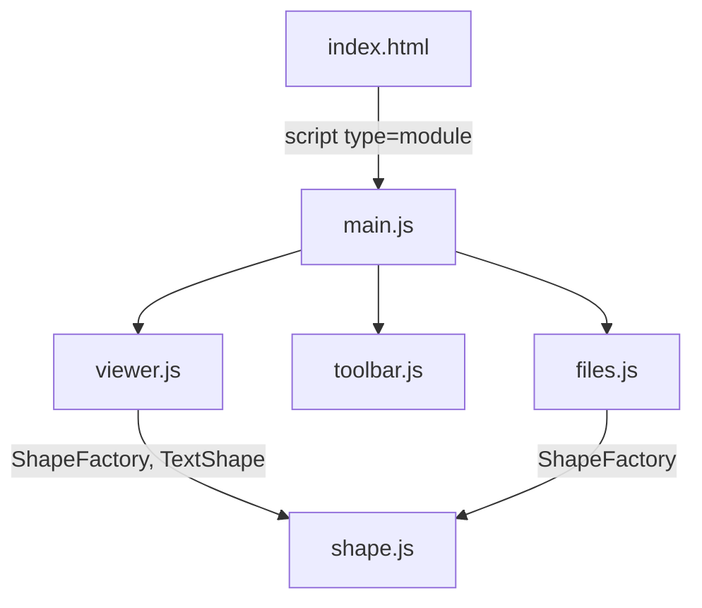
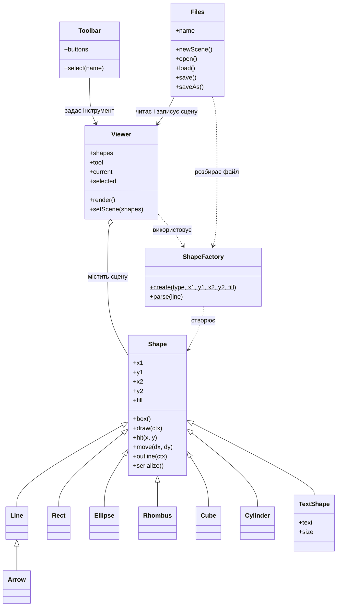

# РГР №4. Векторний графічний редактор

Дисципліна: «Об'єктно-орієнтоване програмування».
Мова: JavaScript (ES6), HTML5 Canvas.

## Запуск

1. Відкрити папку проєкту у VS Code.
2. Встановити розширення **Live Server** і натиснути **Go Live** на `index.html`.
3. Або в терміналі: `npm start` (потрібен Node.js).

> Відкриття `index.html` подвійним кліком не працює: браузер блокує ES-модулі з `file://`.

## Структура проєкту

```
RGR/
├── index.html
├── package.json
├── README.md
└── src/
    ├── shape.js
    ├── viewer.js
    ├── toolbar.js
    ├── files.js
    └── main.js
```

## Діаграма модулів (import-ієрархія)



Текстовий вигляд:

```
index.html
└── main.js
    ├── viewer.js
    │   └── shape.js
    ├── toolbar.js
    └── files.js
        └── shape.js
```

## Діаграма класів



Зв'язки: `<|--` — успадкування, `o--` — агрегація, `-->` — асоціація, `..>` — залежність.

## Опис модулів

| Модуль | Призначення | Основні класи |
|---|---|---|
| `shape.js` | Елементи-форми | `Shape`, `Line`, `Arrow`, `Rect`, `Ellipse`, `Rhombus`, `Cube`, `Cylinder`, `TextShape`, `ShapeFactory` |
| `viewer.js` | Відображення сцени, обробка миші | `Viewer` |
| `toolbar.js` | Панель інструментів з підказками | `Toolbar` |
| `files.js` | Запис і читання файлів сцен | `Files` |
| `main.js` | Ініціалізація та меню «Файл» | — |

## Формат файлу сцени

Текстовий: один рядок — одна фігура.

```
Rect 50 40 200 160 #ffc000
Ellipse 250 60 400 140 #c6efce
TextShape 60 200 #000000 Привіт
```

Формат рядка: `Тип x1 y1 x2 y2 колір`. Для тексту: `TextShape x y колір текст`.